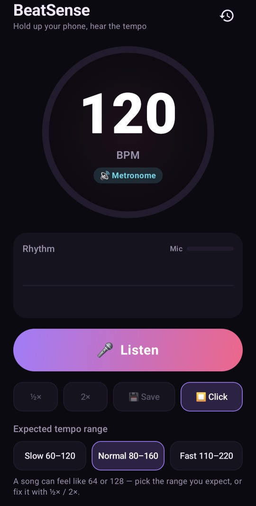

# BeatSense

Hold up your phone and hear the tempo. BeatSense listens to music through the microphone and tells you its **BPM** within a few seconds. A free, open-source BPM counter, tap tempo and metronome for DJs, musicians and dancers.

**Try it:** open the **web app** in your browser (the GitHub Pages link in the **About** box), or grab the Android APK from the [latest release](../../releases/latest). No music nearby? The web app has a demo beat.

<p align="center"></p>

- **Live BPM detection** that locks in within about 6 seconds on songs with drums, with a pulsing dial that beats in time with the music
- **Tempo range** (Slow 60–120, Normal 80–160, Fast 110–220) plus **½× / 2×** buttons to fix the classic "is it 64 or 128?" ambiguity
- **Tap tempo** to double-check by hand
- **Metronome** with an accented downbeat, sample-accurate so it doesn't drift over a long song
- **Saved tempos**: name a song, keep its BPM, and replay it on the metronome later
- Shows the tempo marking (Andante, Allegro…) and typical genres for that speed
- Live rhythm visualizer and mic level meter

Everything runs on your device. The audio is analysed in memory and never recorded, stored or sent anywhere, and the Android app has no internet permission.

## Install

**Android:** download the APK from the [latest release](../../releases/latest), open it on your phone (Android 8.0 or newer) and allow installing from your browser or file manager.

**Any device with a browser:** use the web app below.

## Web app

The same BeatSense runs in the browser on phones, tablets and computers: Chrome, Edge, Firefox and Safari. Open the GitHub Pages site of this repository (link in the **About** box) and allow the microphone.

- **Same detector** as the Android app, ported line by line to JavaScript ([`docs/tempo.js`](docs/tempo.js)) and checked against the same synthetic drum-loop tests
- **Same features:** live BPM, tempo ranges and ½× / 2×, tap tempo (button or the **T** key), metronome, and saved tempos (kept in your browser)
- **Demo beat:** no music nearby? *Try a demo beat* plays a drum loop at a hidden tempo and lets you watch BeatSense find it. When it locks on, it tells you whether it was right.
- **Install it like an app:** use *Install app* or *Add to Home screen* in your browser. It then opens full screen and works offline.
- Keeps the screen awake while listening, and stops listening when you switch tabs

The web app lives in [`docs/`](docs): `index.html` (the app), `tempo.js` (the detector), plus the manifest, icons and an offline service worker. It has no build step and no dependencies. To run it locally, serve that folder over http (for example `python -m http.server --directory docs`) and open `http://localhost:8000`. Browsers only allow the microphone on https or localhost.

## How it works

The detector in [`TempoDetector.kt`](app/src/main/java/com/beatsense/app/dsp/TempoDetector.kt) (and its web port [`tempo.js`](docs/tempo.js)) runs in three steps:

1. **Spectral flux**: each 1024-sample FFT frame (about 11 ms apart) is compared with the previous one, and the rises in log energy across all frequencies are summed. Drum hits and note attacks show up as spikes.
2. **Autocorrelation** of the last 12 seconds of onset strength shows how often the spikes repeat. Harmonics (2× and 3× the period) are added so the real beat beats its subdivisions, and a gentle preference around 120 BPM settles half/double ambiguity. The result is folded into the chosen tempo range and refined on a fine fractional grid.
3. **Beat phase**: a comb at the detected period is slid over the recent onsets, so the dial can pulse on the beat.

The app reads the phone's *unprocessed* microphone source when it's available, because voice processing (noise suppression, auto gain) flattens drums.

## Build

You need JDK 17 and the Android SDK (platform 35).

```bash
./gradlew assembleRelease    # APK in app/build/outputs/apk/release/
./gradlew test               # tempo detector tests on synthetic drum loops
```

The unit tests render drum loops at known tempos (house, hip-hop, drum & bass, a ballad, a loop with human timing jitter) and check that the detector finds each tempo within 1 BPM.

The web version's detector runs the same tests in Node, at both 44.1 and 48 kHz:

```bash
node --test web-tests/tempo.test.js
```

The Android app is built with Kotlin and Jetpack Compose; the web app is plain HTML and JavaScript.

## License

[MIT](LICENSE)
