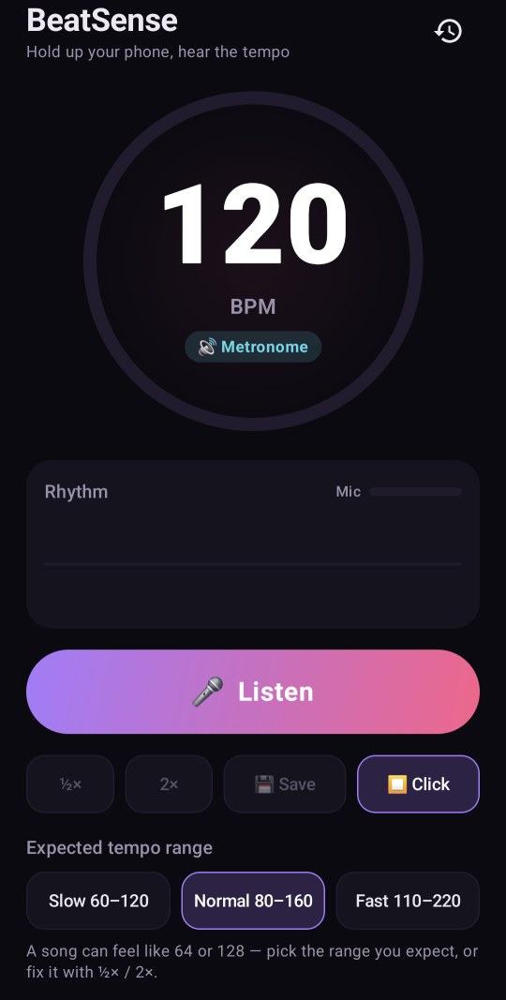

# BeatSense

Hold up your phone and hear the tempo. BeatSense listens to music through the microphone and tells you its **BPM** and **key** within a few seconds. A free, open-source BPM and key finder, tap tempo, metronome and MIDI clock for DJs, musicians and dancers.

**Try it:** open the **[web app](https://heditrigui.github.io/beatsense/)** in your browser, or grab the Android APK from the [latest release](../../releases/latest). No music nearby? The web app has a demo beat.

<p align="center"></p>

- **Live BPM detection** that locks in within about 6 seconds on songs with drums, with a pulsing dial that beats in time with the music
- **Key detection**: shows the musical key next to the BPM, with its Camelot code for harmonic mixing (for example *A minor · 8A*)
- **Analyse audio files**: pick songs or a whole folder and get each one's BPM and key, then export the list as CSV
- **Tempo over time**: a graph of the tempo during a listening session, and a switch to keep listening through a whole live set or mix
- **MIDI clock**: sends the detected, tapped or metronome tempo as MIDI clock, so drum machines, synths and DAW apps play along
- **Tempo range** (Slow 60–120, Normal 80–160, Fast 110–220) plus **½× / 2×** buttons to fix the classic "is it 64 or 128?" ambiguity
- **Tap tempo** to double-check by hand
- **Metronome** with an accented downbeat, sample-accurate so it doesn't drift over a long song
- **Saved tempos**: name a song, keep its BPM, and replay it on the metronome later
- Shows the tempo marking (Andante, Allegro…) and typical genres for that speed
- Live rhythm visualizer and mic level meter

Everything runs on your device. The audio is analysed in memory and never recorded, stored or sent anywhere, and the Android app has no internet permission. Audio files you analyse are read on the device and never uploaded; the CSV is only written where you choose to save it.

## Install

**Android:** download the APK from the [latest release](../../releases/latest), open it on your phone (Android 8.0 or newer) and allow installing from your browser or file manager.

**Any device with a browser:** use the web app below.

## Web app

The same BeatSense runs in the browser on phones, tablets and computers: Chrome, Edge, Firefox and Safari. Open **[https://heditrigui.github.io/beatsense/](https://heditrigui.github.io/beatsense/)** and allow the microphone.

- **Same detector** as the Android app, ported line by line to JavaScript ([`docs/tempo.js`](docs/tempo.js)) and checked against the same synthetic drum-loop tests
- **Same features:** live BPM and key, tempo ranges and ½× / 2×, tap tempo (button or the **T** key), metronome, tempo over time, file analysis with CSV export, and saved tempos (kept in your browser)
- **MIDI clock** through Web MIDI in Chrome, Edge and Opera (Firefox asks for permission; Safari has no Web MIDI). To feed a DAW on the same computer, send it to a virtual MIDI port (loopMIDI on Windows, the IAC Driver on macOS).
- **Demo beat:** no music nearby? *Try a demo beat* plays a drum loop with chords at a hidden tempo and key, and lets you watch BeatSense find them. When it locks on, it tells you whether it was right.
- **Install it like an app:** use *Install app* or *Add to Home screen* in your browser. It then opens full screen and works offline.
- Keeps the screen awake while listening, and stops listening when you switch tabs

The web app lives in [`docs/`](docs): `index.html` (the app), `tempo.js` (the tempo detector), `key.js` (the key detector), `track.js` (file analysis and CSV), `midi.js` (MIDI clock timing), plus the manifest, icons and an offline service worker. It has no build step and no dependencies. To run it locally, serve that folder over http (for example `python -m http.server --directory docs`) and open `http://localhost:8000`. Browsers only allow the microphone on https or localhost.

## How it works

The detector in [`TempoDetector.kt`](app/src/main/java/com/beatsense/app/dsp/TempoDetector.kt) (and its web port [`tempo.js`](docs/tempo.js)) runs in three steps:

1. **Spectral flux**: each 1024-sample FFT frame (about 11 ms apart) is compared with the previous one, and the rises in log energy across all frequencies are summed. Drum hits and note attacks show up as spikes.
2. **Autocorrelation** of the last 12 seconds of onset strength shows how often the spikes repeat. Harmonics (2× and 3× the period) are added so the real beat beats its subdivisions, and a gentle preference around 120 BPM settles half/double ambiguity. The result is folded into the chosen tempo range and refined on a fine fractional grid.
3. **Beat phase**: a comb at the detected period is slid over the recent onsets, so the dial can pulse on the beat.

The app reads the phone's *unprocessed* microphone source when it's available, because voice processing (noise suppression, auto gain) flattens drums.

### Key

The key detector in [`KeyDetector.kt`](app/src/main/java/com/beatsense/app/dsp/KeyDetector.kt) (web port: [`key.js`](docs/key.js)):

1. **Chromagram**: the audio is low-passed and decimated to about 11 kHz, and every 4096-point FFT frame between 65 Hz and 2.1 kHz is folded into 12 pitch classes (how much C, C♯, D… is sounding). Each frame is normalised, so loud and quiet passages count alike, and silent frames are skipped.
2. **Key profiles**: the summed chromagram is correlated with the Krumhansl-Kessler major and minor key profiles, rotated to all 24 keys. The best match is the key, and its margin over the runner-up gives the confidence.
3. **Camelot code**: the key is shown with its position on the Camelot wheel (8A = A minor, 8B = C major), so DJs can find tracks that mix well.

While listening, the chromagram slowly forgets (about 30 seconds), so a key change shows up; for a file, the whole song counts.

### Files, tempo history and MIDI clock

- **Files** ([`TrackAnalyzer.kt`](app/src/main/java/com/beatsense/app/dsp/TrackAnalyzer.kt), [`track.js`](docs/track.js)): the decoded audio goes through the same tempo detector as live listening, with an estimate every 3 seconds over its 12-second window. The file's BPM is the median of the confident estimates. Android decodes with the phone's own codecs (`MediaExtractor` and `MediaCodec`) and streams the samples into the analyser, so long mixes need little memory; the browser uses `decodeAudioData`. Files and folders are opened through the system picker, so the app needs no storage permission.
- **Tempo over time** plots one point a second of the tempo on the dial. Turn on *Keep listening* to go past the usual 45-second auto-stop.
- **MIDI clock** sends 24 clocks per beat with Start and Stop. On Android, other apps on the phone see BeatSense as a MIDI device called **BeatSense Clock** (a `MidiDeviceService`), and you can also send to a USB or Bluetooth MIDI device. Tempo changes bend the clock smoothly from the next tick. MIDI uses no network.
- **Ableton Link is not included.** Link is licensed under the GPL (or a separate proprietary license), which doesn't fit this MIT project, and it syncs over the local network, which would mean giving the Android app the internet permission it deliberately doesn't have.

## Build

You need JDK 17 and the Android SDK (platform 35).

```bash
./gradlew assembleRelease    # APK in app/build/outputs/apk/release/
./gradlew test               # detector tests on synthetic songs
```

The unit tests render drum loops at known tempos (house, hip-hop, drum & bass, a ballad, a loop with human timing jitter) and check that the detector finds each tempo within 1 BPM. The key tests add chord progressions in known keys (major and minor, across the circle of fifths) on top of the drums. Further tests cover a key change, whole-file analysis (tempo, key, a drifting tempo, short files, chunking), the CSV export and the MIDI clock timing.

The web version runs the same tests in Node, at both 44.1 and 48 kHz:

```bash
node --test web-tests/tempo.test.js web-tests/key.test.js web-tests/track.test.js
```

The Android app is built with Kotlin and Jetpack Compose; the web app is plain HTML and JavaScript.

## License

[MIT](LICENSE)
